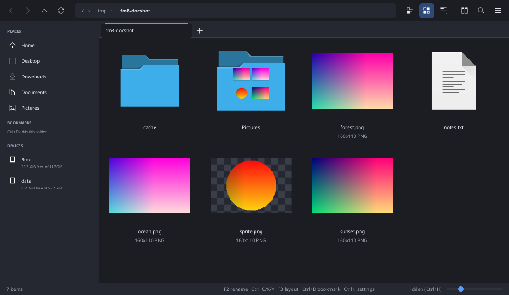
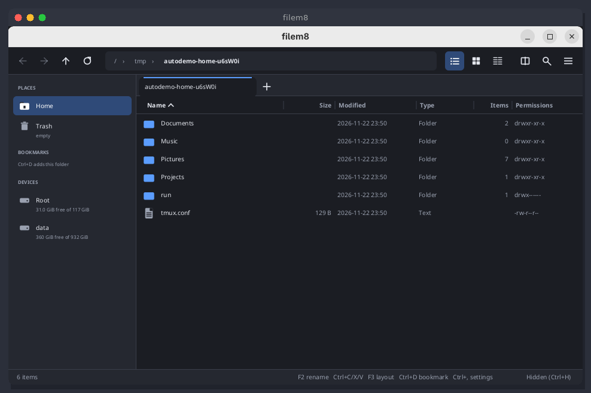

# filem8

A small, fast GUI file manager in Rust with its **own widget toolkit** (no GTK/Qt/egui).
Goal: Thunar's minimalism with Dolphin-class features and better UX: tabs, split panes, bookmarks,
previews for images/audio/3D/game assets, keyboard first.

    ./run              # builds release (nice -n 19) and opens the window
    FM8_FULL=1 ./run   # also audio playback, AVIF/WebP/progressive JPEG via extra crates
    ./run --get-icons  # asks, then downloads the Papirus icon theme (GPL-3) to ~/.local/share/icons

Knobs (env): `FM8_BACKEND=vulkan|gl|soft` (default: vulkan then GL, then automatic CPU surface), `FM8_SCALE=1.5`.
Theme: `~/.config/filem8/theme` (colorado `.theme` format, reloaded live when the file changes; see docs/colorado-generator.md).
Headless render of the real UI: `filem8 --screenshot out.png [DIR] [WxH] [SCALE]`.

## Crates

| crate | what |
|---|---|
| `fm8-ui` | immediate-mode widgets, layout, theme, display list, CPU rasteriser (software fallback + golden tests) |
| `fm8-core` | model: async listing, sort/filter/selection, file ops + undo, own freedesktop trash, bookmarks, mounts, recents, inotify watch, fuzzy, icon-theme lookup, thumbnail cache naming (own MD5) |
| `fm8-codec` | own std-only decoders: PNG/JPEG(baseline)/GIF/BMP/QOI/TGA/PNM/TIFF/ICO/HDR, tar, zip, inflate |
| `fm8-preview` | preview loaders: images, text, archives, own glTF/GLB/OBJ/STL + software 3D renderer, PDF page 1 (poppler), audio waveform (`full`) |
| `filem8` | the app: window (winit), presenter (wgpu, CPU fallback), UI composition, thumbnails, icon set, async transfers |

Light build keeps resvg (SVG icons for breeze/Papirus) as its one heavy dependency; `full` adds symphonia/cpal audio and the `image` crate for AVIF/WebP/progressive JPEG.

## Feature table (honest)

**done** = implemented and covered by `cargo test`; **built** = implemented, not automatically tested or not seen on real hardware.

| feature | status |
|---|---|
| own widget system, virtual list/grid, tabs, split, menu, tooltip, DPI | done |
| headless render to PNG + golden tests (`--screenshot`) | done |
| window on Wayland (winit), wgpu presents the CPU raster, softbuffer fallback | built (never run on the real dwl screen by the author's agent) |
| GPU-native draw | planned (CPU rasterise now) |
| list (resizable/toggleable columns: size, date, type, MIME, perms, owner, items), tiles, compact; per-folder memory | done |
| tiles: real thumbnails (images, PDF, 3D, video via ffmpeg, audio waveform), size 64-512px slider, checkerboard for alpha, folder collage, info line, hover animation, freedesktop disk cache | done (video/PDF need ffmpeg/pdftoppm, untested without them) |
| icons from the freedesktop theme (breeze/Papirus/Adwaita, SVG+PNG), symbolic toolbar icons tinted to the UI | done (Papirus unverified on this machine) |
| filter bar (Ctrl+F, fuzzy name), type-to-find | done (content search **planned**) |
| rename, copy/cut/paste, drag and drop, new folder, trash, undo | done |
| async copy/move with progress panel and cancel | done |
| preview pane in the window (F3), dual pane with per-pane tabs, F5 copy / F6 move | done |
| bookmarks (add/rename/reorder/remove/drop; GTK compatible), XDG dirs, mounts (one per device), recents | done |
| settings panel (Ctrl+,) persisted, live apply; editable key bindings | done |
| breadcrumbs (full path) + editable path bar with completion | done |
| audio playback | built |

## Keys

Arrows/PgUp/PgDn/Home/End move; Enter open; Backspace back (or up); Alt+Left/Right/Up history/parent;
Ctrl+L path; Ctrl+F filter; Ctrl+T/W tabs; Ctrl+Tab next tab; Ctrl+H hidden; Ctrl+A all; Ctrl+C/X/V; Del trash; Ctrl+Z undo;
Ctrl+1/2/3 list/tiles/compact; F2 rename; F3 layout (single/dual/preview); F5/F6 copy/move to the other pane; Ctrl+D bookmark; Ctrl+, settings; Ctrl+Q quit.

The clip is recorded from outside by autodemo driving the real window (`docs/demo.demo`).

## Design notes

* Immediate mode: the UI is a pure function of state; persistent bits (scroll, split ratio, caret, focus) live in `Ui` keyed by hashed ids.
* Everything the widgets draw is a backend-neutral display list; `soft` rasterises it on the CPU, so tests need no GPU and `FM8_BACKEND=soft` works everywhere.
* Minimal dependencies: trash, config parser, image/tar/zip decoders, inotify, MIME sniffing, MD5, glTF are own std-only modules. Honest limits: no progressive JPEG/WebP/AVIF without `full`; TIFF without tiles/planar/CMYK; no EXIF orientation.
* Tests never touch real files: temp dirs, trash tests set `XDG_DATA_HOME`, thumbnail tests `XDG_CACHE_HOME`.
